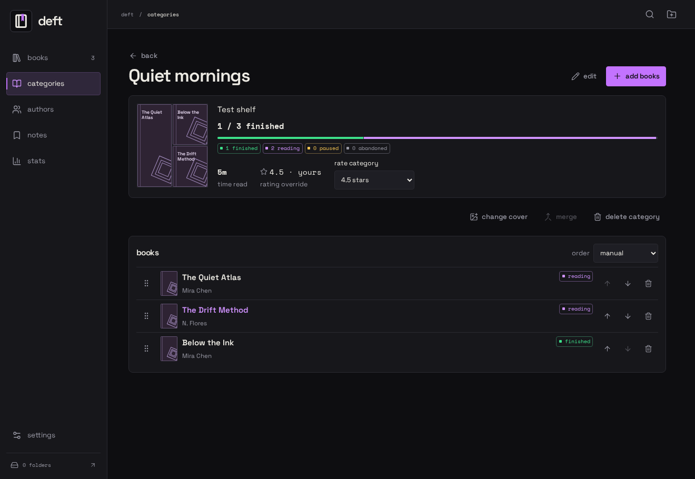

# deft desktop

Deft is an offline ebook reader and reading tracker for Windows. Point it at a folder, open a book, and read. It remembers your place, records foreground reading time, and keeps your history when the original file moves or goes missing.

## Run on Windows

Use Windows 10 or 11 with Microsoft Edge WebView2, Microsoft C++ Build Tools with **Desktop development with C++**, Rust **1.88+** with the MSVC toolchain, and Node.js **22.12+**.

```powershell
npm ci
npm run tauri dev
```

In Deft, choose **add a folder** and select a directory containing ebooks. Subfolders are scanned recursively. Settings → library manages subfolder exclusions, file types, ignored books, and rescans.

To build a Windows x64 NSIS installer with the offline WebView2 installer included:

```powershell
npm run tauri build -- --bundles nsis --ci -- --locked
```

The installer is written to `target/release/bundle/nsis/`. The same command runs in GitHub Actions. For signed tagged builds, configure `DEFT_SIGNING_PFX` (base64 PFX) and `DEFT_SIGNING_PASSWORD`; builds without signing secrets are unsigned. Tags such as `v0.1.0-1` publish a prerelease.

The Tauri source also supports building on Linux and macOS for development. Install the applicable Tauri system prerequisites. Windows is the release target and the installed-dictionary and display-awake integrations are Windows-specific. [Tauri prerequisites](https://v2.tauri.app/start/prerequisites/)

## What you can do

- Read EPUB, TXT, FB2, MOBI, AZW, AZW3, PDF, DjVu and CBZ. Use **← / →**, **Page Up / Page Down**, or the reader controls to navigate. **Ctrl+F** searches the library or book, **F11** toggles reader fullscreen, and **Esc** backs out of the reader or dismisses its tools.
- Browse your library by title, author, format, category or reading state. Rate in half-stars, favorite books, write reviews, edit metadata and manage series or custom categories.
- Save bookmarks, highlight and annotate reflowable text, or write a page note on a fixed-layout book. Open an annotation from the Notes screen to return to its location.
- Track active sessions, read-throughs, streaks, pace, goals and year-in-review stats. Short segments are discarded; browsing a finished book stays out of aggregate stats.
- Match editions deliberately, then export a Goodreads CSV or Deft Reading Profile. Create a local backup ZIP, restore it, or set a weekly rotating backup. See [data exchange](docs/data-exchange.md).



[See the stats screen](docs/screenshots/stats.png)

## Data and privacy

Deft opens book files read-only and stores edits and reading history in its own SQLite database. A SHA-256 identifies a file version. Copies of identical content share one Book, changed content creates a new Book, and a returning file reattaches to its existing history.

Deft uses neither an account nor analytics. Only an explicit edition lookup or cover download contacts a network provider. Lookup sends an ISBN or title and first author. Passwords entered to open password-protected PDFs stay in memory. DRM-protected books appear in the library as **protected**.

On Windows the application database is normally at `%LOCALAPPDATA%\com.kmab.deft\deft.sqlite3`. Backup ZIPs contain Deft data including folder paths, and can contain private notes and provider credentials. They exclude ebook files.

## Development

```sh
npm ci
npm run check
npm test
npm run build
cargo fmt --all -- --check
cargo test --locked -p deft-core
```

- `src/` contains the React interface, book navigation, reader, and statistics.
- `crates/deft-core/` contains format parsing, the scanner, domain models, tracking, SQLite, matching and exchange.
- `src-tauri/` owns Windows integration, dialogs, read-only publication access, the cache, and application packaging.
- [Desktop scope and verification](docs/desktop-implementation.md) maps the original milestones to implementation and names the remaining platform differences and gaps.
- [Windows acceptance checklist](docs/windows-acceptance.md) covers a first installer smoke test. The original Android reference is preserved under [plans/](plans/).

[GPL-3.0-only](LICENSE) · [Third-party notices](docs/third-party.md) · [Original Deft project](https://github.com/kmab5/deft)
